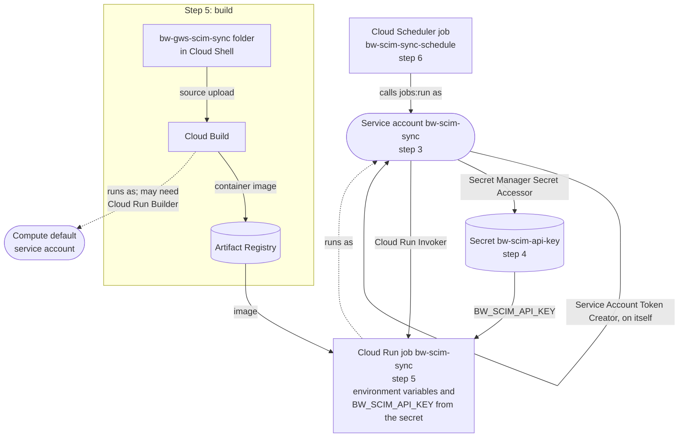

# Manual Google Cloud setup

This guide does by hand everything that `setup.sh` does (README Step 2), for organizations that
prefer to make and review each Google Cloud change themselves. Each step shows the Google Cloud
console path and the equivalent `gcloud` command. Use whichever you prefer.

When you finish, continue with **README Step 3** (domain-wide delegation).

> Maintainers: this file must match `setup.sh`. When the script changes, update the matching section
> here. The table at the end maps each script step to its section.

## What you'll create

The numbers match the sections below. An arrow labelled with a role means the account at the start
holds that role on the resource at the end. Step 1 (billing) and step 2 (the seven APIs) don't
create resources, so they aren't drawn.



## Values used below

| Placeholder | Example | Notes |
|---|---|---|
| `PROJECT_ID` | `acme-bitwarden-sync` | Your Google Cloud project. |
| `PROJECT_NUMBER` | `123456789012` | Shown on the console home page for the project. |
| `REGION` | `us-central1` | Use the same region in every step. |
| `SA_EMAIL` | `bw-scim-sync@PROJECT_ID.iam.gserviceaccount.com` | Created in step 3. |

The names `bw-scim-sync`, `bw-scim-api-key` and `bw-scim-sync-schedule` are the ones the README
commands and `select-groups.sh` use. Keep them, or the README commands need adjusting and
`select-groups.sh` won't find the job.

To use the `gcloud` commands, open [Cloud Shell](https://shell.cloud.google.com) and set the
variables once:

```bash
PROJECT_ID=acme-bitwarden-sync
REGION=us-central1
SA_EMAIL=bw-scim-sync@$PROJECT_ID.iam.gserviceaccount.com
gcloud config set project $PROJECT_ID
```

## 1. Check billing

Cloud Run, Cloud Build and Cloud Scheduler need a billing account.

- **Console:** **Billing → Account management**, and check that the project is linked to an account.
- **gcloud:**
  ```bash
  gcloud billing projects describe $PROJECT_ID --format 'value(billingEnabled)'   # must print True
  ```

## 2. Enable the APIs

- **Console:** **APIs & Services → Library**. Search for and enable each of these:
  - Cloud Run Admin API
  - Cloud Build API
  - Artifact Registry API
  - Cloud Scheduler API
  - Secret Manager API
  - IAM Service Account Credentials API
  - Admin SDK API
- **gcloud:**
  ```bash
  gcloud services enable run.googleapis.com cloudbuild.googleapis.com artifactregistry.googleapis.com \
    cloudscheduler.googleapis.com secretmanager.googleapis.com iamcredentials.googleapis.com \
    admin.googleapis.com
  ```

## 3. Create the service account

The job runs as this account. It never gets a key file: it signs its own short-lived token for
directory access, which is why it needs the **Service Account Token Creator** role **on itself**.

- **Console:**
  1. **IAM & Admin → Service accounts → Create service account**.
  2. **Service account ID:** `bw-scim-sync`, **Name:** `Bitwarden SCIM sync`. Select **Create and
     continue**, skip the optional role steps, and select **Done**.
  3. Open the new account, go to the **Principals with access** (or **Permissions**) tab, and select
     **Grant access**.
  4. **New principals:** the account's own email (`SA_EMAIL`). **Role:** **Service Account Token
     Creator**. Select **Save**.
- **gcloud:**
  ```bash
  gcloud iam service-accounts create bw-scim-sync --display-name "Bitwarden SCIM sync"
  gcloud iam service-accounts add-iam-policy-binding $SA_EMAIL \
    --member "serviceAccount:$SA_EMAIL" --role roles/iam.serviceAccountTokenCreator
  ```

A new service account can take a minute or two to become usable. If the second command fails with
`NOT_FOUND` or `PERMISSION_DENIED`, wait and try again.

## 4. Store the SCIM API key

- **Console:**
  1. **Security → Secret Manager → Create secret**.
  2. **Name:** `bw-scim-api-key`. **Secret value:** the SCIM API key from README Step 1. Leave the
     other options at their defaults and select **Create secret**.
  3. On the secret's page, open the **Permissions** tab and select **Grant access**.
  4. **New principals:** `SA_EMAIL`. **Role:** **Secret Manager Secret Accessor**. Select **Save**.
- **gcloud** (what you type is hidden):
  ```bash
  gcloud secrets create bw-scim-api-key --replication-policy automatic
  read -rs -p "SCIM API key: " KEY; echo
  printf '%s' "$KEY" | gcloud secrets versions add bw-scim-api-key --data-file=-; unset KEY
  gcloud secrets add-iam-policy-binding bw-scim-api-key \
    --member "serviceAccount:$SA_EMAIL" --role roles/secretmanager.secretAccessor
  ```

## 5. Build and deploy the job

The job is built from the `bw-gws-scim-sync` folder. Upload and unzip it in Cloud Shell as in README
Step 2, and run the commands below from inside the folder.

**Before you build:** builds run as the Compute Engine default service account,
`PROJECT_NUMBER-compute@developer.gserviceaccount.com`. Many organizations remove its default
permissions, which makes the build fail. If that applies to you, grant it **Cloud Run Builder**:

- **Console:** **IAM & Admin → IAM → Grant access**. Principal:
  `PROJECT_NUMBER-compute@developer.gserviceaccount.com`. Role: **Cloud Run Builder**.
- **gcloud:**
  ```bash
  PROJECT_NUMBER=$(gcloud projects describe $PROJECT_ID --format 'value(projectNumber)')
  gcloud projects add-iam-policy-binding $PROJECT_ID \
    --member "serviceAccount:$PROJECT_NUMBER-compute@developer.gserviceaccount.com" \
    --role roles/run.builder
  ```

The job needs these settings, whichever option you use:

| Setting | Value |
|---|---|
| Job name | `bw-scim-sync` |
| Region | `REGION` |
| Service account | `SA_EMAIL` |
| Environment variable `BW_SCIM_URL` | The SCIM URL from README Step 1 |
| Environment variable `GOOGLE_ADMIN_EMAIL` | The Google Workspace admin the sync reads the directory as |
| Environment variable `GOOGLE_SA_EMAIL` | `SA_EMAIL` |
| Environment variable `GOOGLE_GROUPS` | Comma-separated Google group emails. **Optional here:** leave it out and pick the groups from your directory with `select-groups.sh` (README Step 4). |
| Environment variable `DRY_RUN` | `true` |
| Secret exposed as environment variable `BW_SCIM_API_KEY` | Secret `bw-scim-api-key`, version `latest` |
| Maximum retries | `0` |
| Task timeout | `30m` |

The other settings in the README's **Settings** table are optional. Add them the same way if you
need them.

### Option A: one command (the same as `setup.sh`)

This builds the image and deploys the job in one step. `"^;^"` makes `;` the separator between
variables, because the values contain commas. To pick the groups later with `select-groups.sh`,
remove `GOOGLE_GROUPS=...;` from the command.

```bash
gcloud run jobs deploy bw-scim-sync --source . --region $REGION \
  --service-account $SA_EMAIL \
  --set-secrets "BW_SCIM_API_KEY=bw-scim-api-key:latest" \
  --update-env-vars "^;^BW_SCIM_URL=https://scim.bitwarden.com/v2/ORG_ID;GOOGLE_ADMIN_EMAIL=admin@acme.com;GOOGLE_SA_EMAIL=$SA_EMAIL;GOOGLE_GROUPS=engineering@acme.com,finance@acme.com;DRY_RUN=true" \
  --max-retries 0 --task-timeout 30m
```

The first time, `gcloud` asks to create an Artifact Registry repository named
`cloud-run-source-deploy`. Answer **Y**.

### Option B: build the image, then create the job in the console

1. **Create a repository for the image.** Console: **Artifact Registry → Create repository**.
   **Name:** `bw-scim-sync`, **Format:** Docker, **Location type:** Region, **Region:** `REGION`.
   Or with gcloud:
   ```bash
   gcloud artifacts repositories create bw-scim-sync --repository-format docker --location $REGION
   ```
2. **Build the image.** Building from the folder needs this one command in Cloud Shell; the console
   has no equivalent:
   ```bash
   gcloud builds submit --tag $REGION-docker.pkg.dev/$PROJECT_ID/bw-scim-sync/bw-scim-sync:latest
   ```
3. **Create the job.** Console: **Cloud Run → Jobs → Deploy container** (or **Create job**).
   - **Container image URL:** select the image built in step 2.
   - **Job name** and **Region:** from the settings table.
   - **Container(s), Volumes, Connections, Security**:
     - **Variables & Secrets:** add the environment variables from the table (`GOOGLE_GROUPS` is
       optional) and `DRY_RUN=true`. Under
       **Secrets exposed as environment variables**, select **Reference a secret**: name
       `BW_SCIM_API_KEY`, secret `bw-scim-api-key`, version `latest`.
     - **Task timeout:** 30 minutes. **Number of retries per failed task:** 0.
     - **Security → Service account:** `bw-scim-sync`.
   - Select **Create**. Don't select **Execute job immediately** yet.

To update the job to a new version later with option B, build a new image (step 2), then in the
console open the job, select **Edit**, choose the new image, and select **Update**.

## 6. Schedule the job

The service account starts the job on a schedule, so it needs the **Cloud Run Invoker** role on the
job.

- **Console:**
  1. **Cloud Run → Jobs**, select the checkbox next to `bw-scim-sync`, then **Permissions → Add
     principal**. **New principals:** `SA_EMAIL`. **Role:** **Cloud Run Invoker**. Select **Save**.
  2. Open the job, go to the **Triggers** tab, and select **Add scheduler trigger**.
  3. **Name:** `bw-scim-sync-schedule`. **Frequency:** `0 * * * *` (hourly) or your own cron
     expression. **Time zone:** your choice. **Service account:** `bw-scim-sync`. Select **Create**.
- **gcloud:**
  ```bash
  gcloud run jobs add-iam-policy-binding bw-scim-sync --region $REGION \
    --member "serviceAccount:$SA_EMAIL" --role roles/run.invoker
  gcloud scheduler jobs create http bw-scim-sync-schedule --location $REGION \
    --schedule "0 * * * *" --time-zone "Etc/UTC" \
    --uri "https://run.googleapis.com/v2/projects/$PROJECT_ID/locations/$REGION/jobs/bw-scim-sync:run" \
    --http-method POST --oauth-service-account-email $SA_EMAIL
  ```

## 7. Get the Client ID

README Step 3 needs the service account's OAuth client ID.

- **Console:** **IAM & Admin → Service accounts → bw-scim-sync**. The **Unique ID** is the Client ID.
- **gcloud:**
  ```bash
  gcloud iam service-accounts describe $SA_EMAIL --format 'value(oauth2ClientId)'
  ```

Now continue with **README Step 3**, then Steps 4 to 6. `select-groups.sh` (Step 4) works the same
after a manual setup.

## What was created

| Resource | Name | Created in |
|---|---|---|
| Enabled APIs | 7 APIs | Step 2 |
| Service account | `bw-scim-sync` | Step 3 |
| IAM: Token Creator on itself | `SA_EMAIL` → `SA_EMAIL` | Step 3 |
| Secret | `bw-scim-api-key` | Step 4 |
| IAM: Secret Accessor | `SA_EMAIL` on the secret | Step 4 |
| IAM: Cloud Run Builder (only if needed) | Compute default service account on the project | Step 5 |
| Artifact Registry repository | `cloud-run-source-deploy` (option A) or `bw-scim-sync` (option B) | Step 5 |
| Cloud Run job | `bw-scim-sync` | Step 5 |
| IAM: Cloud Run Invoker | `SA_EMAIL` on the job | Step 6 |
| Cloud Scheduler job | `bw-scim-sync-schedule` | Step 6 |

To remove everything, follow **Remove the sync completely** in the README. With option B, also
delete the `bw-scim-sync` Artifact Registry repository.

## Mapping to `setup.sh`

| `setup.sh` step | Section here |
|---|---|
| Checks the gcloud account and project, asks for the values | Values used below |
| On a rerun, reads the deployed job's environment variables, the schedule and whether the secret exists, and offers them as defaults | Console: the job's **Configuration** tab and the scheduler job. gcloud: `gcloud run jobs describe bw-scim-sync --region $REGION` and `gcloud scheduler jobs describe bw-scim-sync-schedule --location $REGION` |
| Billing check | 1 |
| `==> Enabling APIs` | 2 |
| `==> Service account` (create, Token Creator on itself) | 3 |
| `==> Storing the SCIM API key in Secret Manager` (secret, version, Secret Accessor). On a rerun, Enter keeps the stored key and no version is added | 4 |
| `==> Building and deploying the Cloud Run job` (`--source`, env vars, secret, retries, timeout) | 5, option A |
| `==> Schedule` (Cloud Run Invoker, Cloud Scheduler HTTP job) | 6 |
| Prints the Client ID, scopes and next steps | 7, then README Steps 3–6 |
| Group prompt (optional; Enter skips it) | `GOOGLE_GROUPS` in the step 5 table, or README Step 4 |

`setup.sh` doesn't grant Cloud Run Builder (step 5). It's only needed when an organization has
removed the default build account's permissions.
