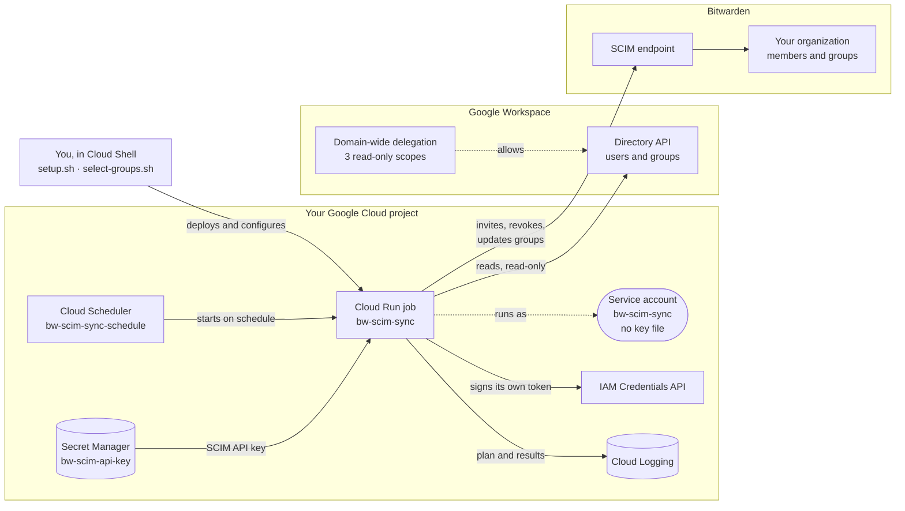
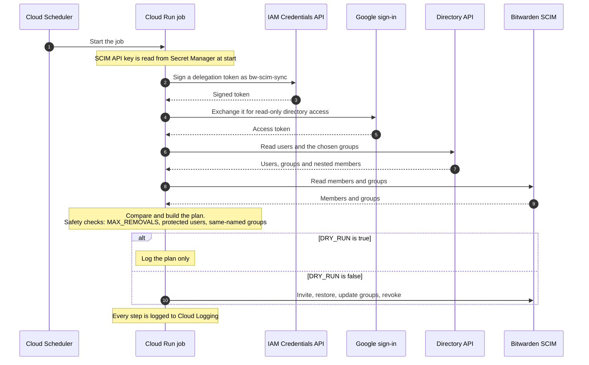
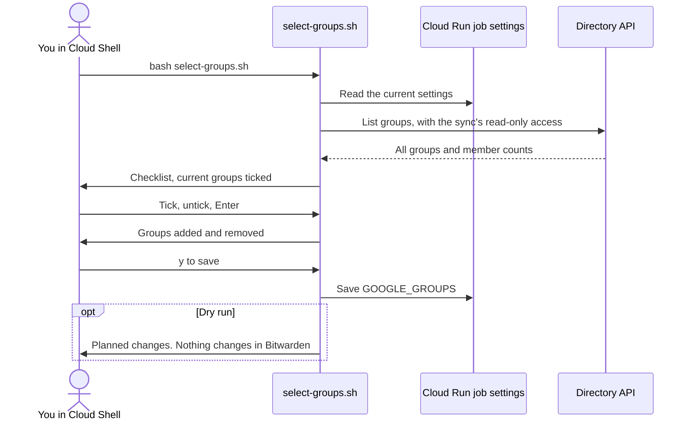

# Sync Google Workspace users and groups to Bitwarden (SCIM)

This tool keeps your Bitwarden organization in step with Google Workspace. On a schedule, it reads
the Google groups you choose and uses Bitwarden's SCIM endpoint to:

- invite new group members to your Bitwarden organization,
- revoke members who leave those groups or are suspended or deleted in Google,
- restore members who return, and
- create a matching Bitwarden group for each Google group and keep its membership current. Members
  of nested groups are included.

It runs in your own Google Cloud project as a small scheduled job, so you don't need a server.
Setup takes about 15 minutes.

**Contents:** [How it works](#how-it-works) · [Before you start](#before-you-start) ·
[Step 1](#step-1-enable-scim-in-bitwarden) · [Step 2](#step-2-set-up-google-cloud) ·
[Step 3](#step-3-allow-the-sync-to-read-your-directory) · [Step 4](#step-4-choose-the-groups-to-sync) ·
[Step 5](#step-5-test-with-a-dry-run) · [Step 6](#step-6-turn-on-syncing) ·
[Existing members and groups](#existing-members-and-groups) ·
[What users and admins see](#what-users-and-admins-see) · [Settings](#settings) ·
[Everyday tasks](#everyday-tasks) · [Self-hosted Bitwarden](#self-hosted-bitwarden) ·
[Troubleshooting](#troubleshooting)

## How it works

| Piece | Where | Purpose |
|---|---|---|
| Cloud Run job `bw-scim-sync` | Your Google Cloud project | Runs one sync pass and exits. |
| Cloud Scheduler job `bw-scim-sync-schedule` | Your Google Cloud project | Starts the job on a schedule (hourly by default). |
| Secret `bw-scim-api-key` | Secret Manager in your project | Holds the Bitwarden SCIM API key. |
| Service account `bw-scim-sync` | Your Google Cloud project | The identity the job runs as. No key file is ever created for it. |
| Domain-wide delegation | Google Admin console | Lets the service account **read** users and groups. It can't change anything in Google Workspace. |



What happens on each run:



## Before you start

You need:

- **A Bitwarden organization on a plan that includes SCIM**, and Owner or Admin access to it.
- **A Google Workspace super admin**, for one step in the Admin console.
- **A Google Cloud project with billing enabled**, and an account that can manage it. Project
  **Owner** is simplest. The job uses a few seconds of compute per run, which normally fits in the
  free tier.
- **To know which Google groups** should get Bitwarden access. You pick them from a list of your
  groups in Step 4, so you don't need to type their addresses.

Good to know before you choose groups:

- Only **users of your Google Workspace** are synced. Group members with outside addresses (for
  example, a personal Gmail account added to a group) are skipped, and the log says so.
- Nested groups are expanded: members of a group inside a synced group are included.
- **Use only one sync tool per Bitwarden organization.** If you use Bitwarden Directory Connector or
  another SCIM integration for this organization, turn it off first.

## Step 1: Enable SCIM in Bitwarden

1. In the Bitwarden web app, open the **Admin Console** for your organization.
2. Go to **Settings → SCIM provisioning**.
3. Turn on **Enable SCIM** and select **Save**.
4. Copy the **SCIM URL** and the **SCIM API key**. You'll enter them in Step 2.

Treat the API key like a password: anyone who has it can add and remove members of your
organization. Don't paste it into email, chat or tickets.

## Step 2: Set up Google Cloud

The setup script does all of the Google Cloud work in one go. If your organization prefers to make
each change by hand, follow [MANUAL_SETUP.md](MANUAL_SETUP.md) instead, then continue with Step 3.

1. Open [Google Cloud Shell](https://shell.cloud.google.com) and select your project at the top of
   the page.
2. Upload `bw-gws-scim-sync.zip` with the **⋮ (More) → Upload** menu, then unzip it and open the
   folder:
   ```
   unzip bw-gws-scim-sync.zip && cd bw-gws-scim-sync
   ```
3. Run the script:
   ```
   bash setup.sh
   ```
4. Answer the prompts. Press **Enter** to accept a value shown in brackets.

| Prompt | What to enter |
|---|---|
| Google Cloud project ID | Your project. It's usually filled in for you. |
| Region | Where the job runs, for example `us-central1` or `europe-west1`. |
| Bitwarden SCIM URL | The URL from Step 1. |
| Bitwarden SCIM API key | The key from Step 1. What you type is hidden. |
| Google Workspace admin email | An admin account the sync reads your directory as. Its access is read-only. |
| Google group email(s) | **Press Enter to skip**, and pick the groups from your directory in Step 4. Or type one or more group emails, separated by commas, for example `engineering@acme.com,finance@acme.com`. |
| Sync schedule (cron) | How often to sync. The default `0 * * * *` runs at the start of every hour. |
| Schedule time zone | The time zone for the schedule, for example `America/New_York`. The default is `Etc/UTC`. |

The script then:

1. Checks that the project exists and has billing.
2. Turns on the Google Cloud APIs the job needs.
3. Creates the `bw-scim-sync` service account and lets it sign its own directory-access tokens.
4. Stores the SCIM API key in Secret Manager as `bw-scim-api-key`.
5. Builds the job from this folder and deploys it. **A new job starts in dry-run mode, so it doesn't
   change anything in Bitwarden yet.**
6. Creates the schedule.

When it finishes, it prints a **Client ID**, a list of **OAuth scopes**, and the next steps. Keep
them for Step 3.

It's safe to run the script again. It updates what already exists, and keeps settings you changed
later, including `DRY_RUN`.

> **Tip:** to skip the prompts, set the answers as environment variables first, for example
> `PROJECT_ID=my-project REGION=us-central1 bash setup.sh`. The variable names are `PROJECT_ID`,
> `REGION`, `BW_SCIM_URL`, `BW_SCIM_API_KEY`, `GOOGLE_ADMIN_EMAIL`, `GOOGLE_GROUPS`, `SCHEDULE` and
> `TIME_ZONE`.

## Step 3: Allow the sync to read your directory

1. Sign in to the Google Admin console as a super admin and open
   [domain-wide delegation](https://admin.google.com/ac/owl/domainwidedelegation)
   (**Security → Access and data control → API controls → Manage domain-wide delegation**).
2. Select **Add new**.
3. In **Client ID**, paste the Client ID the script printed.
4. In **OAuth scopes**, paste this single line:
   ```
   https://www.googleapis.com/auth/admin.directory.user.readonly,https://www.googleapis.com/auth/admin.directory.group.readonly,https://www.googleapis.com/auth/admin.directory.group.member.readonly
   ```
5. Select **Authorize**.

All three scopes are read-only. The change usually takes effect within a few minutes, but can take
longer.

If you lose the Client ID, find it in the Google Cloud console under **IAM & Admin → Service
accounts → bw-scim-sync → Unique ID**, or run:
`gcloud iam service-accounts describe bw-scim-sync@YOUR_PROJECT.iam.gserviceaccount.com --format 'value(oauth2ClientId)'`

## Step 4: Choose the groups to sync

In Cloud Shell, in the same folder as Step 2, run:

```
bash select-groups.sh
```

1. Enter your project and the job's region if asked.
2. The script lists every group in your Google Workspace, with its member count. Groups that are
   already synced are ticked.
3. Select groups with the arrow keys and **Space**. Press **/** and type to filter the list (for
   example `eng`), then **Enter** to go back to the list.
4. Press **Enter** to finish, or **q** to cancel without changes.
5. The script shows the groups you added and removed. Answer **y** to save them on the job.
6. Answer **Enter** (yes) to run a dry run straight away. It shows the plan in Cloud Shell; see Step 5
   for what it means.

The first run takes a little longer: it installs the tool's Python libraries in the folder, and
gives your account permission to read the directory with the sync's read-only access. If it says
it's waiting for permission, that's normal for a minute or two.

If the arrow keys don't work in your terminal, the script falls back to a numbered list: type the
numbers to select (for example `1,3,5-7`), `/text` to filter, and `s` to save.

You can run `select-groups.sh` again at any time to change the groups.



## Step 5: Test with a dry run

If you ran the dry run at the end of Step 4, you've already seen the plan. To run one on Google
Cloud, which also shows that the scheduled job works:

1. In Cloud Shell, run:
   ```
   gcloud run jobs execute bw-scim-sync --region YOUR_REGION --wait
   ```
2. In the Google Cloud console, open **Cloud Run → Jobs → bw-scim-sync → Logs**.
3. Find the **Sync plan** entry. It lists everything the sync would do:

   | Field | Meaning |
   |---|---|
   | `create_users` | People who would get a Bitwarden invitation. |
   | `reactivate` | Revoked members who would be restored. |
   | `revoke` / `delete` | Members who would lose access. |
   | `adopt_users` | Existing members the sync would take over (only with `ADOPT_USERS`). |
   | `groups` | Bitwarden groups that would be created or updated, with their member counts. |
   | `warnings` | Things the sync skipped on purpose. Read these. |

4. Check the plan, especially `revoke`, and any **WARNING** lines above it. If the run fails with
   `unauthorized_client`, the change from Step 3 isn't active yet: wait a few minutes and run it
   again.

Nothing changes in Bitwarden during a dry run.

## Step 6: Turn on syncing

When the plan looks right, run:

```
gcloud run jobs update bw-scim-sync --region YOUR_REGION --update-env-vars DRY_RUN=false
```

From now on, the schedule applies changes automatically. To sync immediately, run the `execute`
command from Step 5 again, then check the logs for `Invited user`, `Created group` and similar
entries.

## Existing members and groups

The sync is careful with what's already in your organization:

| What's already in Bitwarden | What the sync does |
|---|---|
| A member it invited earlier | Manages it fully: keeps group membership current, revokes and restores it. |
| A member provisioned by Directory Connector from Google Workspace | Manages it fully if Directory Connector stored the Google user ID (a long number) as the member's external ID. Otherwise it's treated like a member provisioned by another tool (below): added to synced groups but never revoked. |
| A member with the same email as a Google user, invited by hand | Adds it to the synced groups but **never revokes it**. To let the sync manage it fully, use `ADOPT_USERS`. |
| A member provisioned by another tool (for example, Directory Connector from LDAP or Entra ID) | If its email matches a Google user in a synced group, adds it to the synced groups. Never revokes or adopts it, even with `ADOPT_USERS`. |
| A member who isn't in any synced group, such as an owner | Leaves it alone. |
| A group the sync created earlier | Keeps its name and membership in step with Google. |
| A group with the same name as a synced Google group, which the sync didn't create | **Skips it** and logs a warning, so its current members aren't replaced. To let the sync take it over, use `ADOPT_GROUPS`. |

## What users and admins see

- **New members get an email invitation** from Bitwarden. Each person accepts it and creates or
  signs in to their account, and then an admin confirms them in the Admin Console. Organizations that
  use SSO with trusted devices or automatic confirmation may skip some of these steps.
- **Groups appear in Bitwarden with the same names as in Google**, except where a same-named group
  already existed (see above). To give a group access to collections, assign the collections to the
  group in the Admin Console. The sync manages group membership only, not collection access.
- **People who leave a synced group, or who are suspended or deleted in Google, are revoked**, not
  deleted. They lose access, but an admin can restore them, and the sync restores them
  automatically if they return to a synced group.
- **Name and email changes in Google aren't sent to Bitwarden.**
- **Removing a group from `GOOGLE_GROUPS` leaves its Bitwarden group in place.** Delete it in the
  Admin Console if you no longer need it.

## Settings

Change a setting with:

```
gcloud run jobs update bw-scim-sync --region YOUR_REGION --update-env-vars NAME=value
```

For settings that hold a list, start the value with `^;^`. This tells `gcloud` to separate
settings with `;` instead of commas, so the commas in your list are kept:

```
gcloud run jobs update bw-scim-sync --region YOUR_REGION \
  --update-env-vars "^;^GOOGLE_GROUPS=engineering@acme.com,finance@acme.com"
```

You can also change settings in the Google Cloud console: **Cloud Run → Jobs → bw-scim-sync → Edit
→ Variables & Secrets**. Changes apply from the next run.

For the three list settings, `select-groups.sh` lets you pick from your directory instead of typing
(see [Step 4](#step-4-choose-the-groups-to-sync)):

| Setting | Command |
|---|---|
| `GOOGLE_GROUPS` | `bash select-groups.sh` |
| `PROTECTED_EMAILS` | `bash select-groups.sh --protected-users` |
| `ADOPT_USERS` | `bash select-groups.sh --adopt-users` |

| Setting | Default | Meaning |
|---|---|---|
| `GOOGLE_GROUPS` | (none) | Comma-separated Google groups whose members get Bitwarden access. Required; set it with `select-groups.sh` or during setup. |
| `DRY_RUN` | `true` | When `true`, the job only logs what it would do. |
| `REMOVAL_ACTION` | `revoke` | What happens to members who leave: `revoke`, `delete` (remove from the organization), or `none`. |
| `MAX_REMOVALS` | `10` | If a run would remove more members than this, it stops without changing anything. This protects against mistakes such as a mistyped group. Raise it for a planned bulk change. |
| `PROTECTED_EMAILS` | (empty) | Comma-separated emails the sync never revokes, deletes or adopts. **Add your organization owners here if you turn on `ADOPT_USERS`**, because the sync can't see member roles. |
| `ADOPT_USERS` | `false` | Lets the sync take over members who match a Google user by email and weren't provisioned by any tool (for example, invited by hand). `true` adopts all of them; a comma-separated list adopts only those emails. From then on, adopted members are revoked and restored like members the sync invited. |
| `ADOPT_GROUPS` | (empty) | Comma-separated Google group emails whose same-named Bitwarden group the sync may take over. Its current members are replaced with the Google group's members. |
| `GROUP_UPDATE_MODE` | `put` | How group updates are sent to Bitwarden: `put` or `patch`. Both replace the group's full member list. Leave the default unless Bitwarden support advises otherwise. |

Set by setup, and normally never changed: `BW_SCIM_URL`, `GOOGLE_ADMIN_EMAIL`, `GOOGLE_SA_EMAIL`,
and the `BW_SCIM_API_KEY` secret reference.

## Everyday tasks

**Sync now**
```
gcloud run jobs execute bw-scim-sync --region YOUR_REGION --wait
```

**Change which groups are synced.** Run `bash select-groups.sh`, change the ticks, save, and accept
the dry run it offers. Read the dry run before the next scheduled run: members who are only in
groups you removed get revoked. If the plan isn't what you want, run `select-groups.sh` again, or
pause syncing (below) while you sort it out.

**Choose protected users or users to adopt.** Run `bash select-groups.sh --protected-users` or
`bash select-groups.sh --adopt-users`. Put your organization owners in the protected list if you
use `ADOPT_USERS`.

**Rotate the SCIM API key**
1. In the Bitwarden Admin Console, go to **Settings → SCIM provisioning** and rotate the key. The
   old key stops working immediately.
2. In Cloud Shell, store the new key. What you type is hidden:
   ```
   read -rs -p "New SCIM API key: " KEY; echo
   printf '%s' "$KEY" | gcloud secrets versions add bw-scim-api-key --data-file=-; unset KEY
   ```
   The next run uses the new key. Running `bash setup.sh` again also works.

**Pause and resume syncing**
```
gcloud scheduler jobs pause bw-scim-sync-schedule --location YOUR_REGION
gcloud scheduler jobs resume bw-scim-sync-schedule --location YOUR_REGION
```

**Change the schedule**
```
gcloud scheduler jobs update http bw-scim-sync-schedule --location YOUR_REGION --schedule "0 */4 * * *"
```

**Update to a new version.** Upload and unzip the new version in Cloud Shell, then run
`bash setup.sh` from its folder. Your settings, including `DRY_RUN`, are kept.

**Remove the sync completely**
```
gcloud scheduler jobs delete bw-scim-sync-schedule --location YOUR_REGION
gcloud run jobs delete bw-scim-sync --region YOUR_REGION
gcloud secrets delete bw-scim-api-key
gcloud iam service-accounts delete bw-scim-sync@YOUR_PROJECT.iam.gserviceaccount.com
```
Then delete the Client ID entry from domain-wide delegation in the Google Admin console, and turn
off SCIM in Bitwarden if you no longer use it. Container images remain in Artifact Registry under
`cloud-run-source-deploy`; delete them there if you want. Members and groups already in Bitwarden
stay as they are.

## Self-hosted Bitwarden

SCIM must be enabled on your server (`enable_scim: true` in `config.yml`, then rebuild). The SCIM
URL must also be reachable from Google Cloud, either through your reverse proxy or a private
connection such as a VPN. If you can't expose it, you can run the same container on your own
infrastructure on a schedule, with the same environment variables. Ask Bitwarden support for help
with that setup.

## Troubleshooting

Find the error in **Cloud Run → Jobs → bw-scim-sync → Logs**.

| Message | Fix |
|---|---|
| `unauthorized_client` or `Client is unauthorized` | Step 3 is missing or not active yet. Check the Client ID and that all three scopes are listed, then wait a few minutes. |
| `Google Directory API /groups/... failed: 404` | A group in `GOOGLE_GROUPS` doesn't exist. Check the spelling, and use the group's email address, not its name. |
| `Google Directory API ... 403` | The admin email isn't a Google Workspace admin, or it's in a different Workspace from the groups. |
| `Error calling the IAM signBlob API ... 403` | The service account can't sign its own tokens. Run `bash setup.sh` again. If you just ran it, wait a few minutes: new permissions take time to apply. |
| `SCIM request failed: 401` | The SCIM API key is wrong or was rotated. See **Rotate the SCIM API key** under [Everyday tasks](#everyday-tasks). |
| `GOOGLE_GROUPS must list at least one Google group email` | No groups are chosen yet. Run `bash select-groups.sh` (Step 4). |
| `select-groups.sh`: `Couldn't find the bw-scim-sync job` | Check the region you entered. If you never ran `setup.sh` (or the manual setup), do Step 2 first. |
| `select-groups.sh`: `Google rejected the directory access` | Step 3 is missing or not active yet. Wait a few minutes and run it again. |
| `select-groups.sh`: `Waiting for permission to sign as the service account` | Normal the first time: the script just gave your account access, which takes a minute or two to apply. |
| `Synced groups have no active members` | The groups are empty, or contain only suspended or outside users. Check `GOOGLE_GROUPS`. |
| `Planned removals exceed MAX_REMOVALS` | Read the plan in the log. If the removals are intended, raise `MAX_REMOVALS` for one run, then set it back. |
| `Bitwarden already has a group named ...` | A same-named group existed before the sync. See [Existing members and groups](#existing-members-and-groups). |
| `skipped N member(s) that are suspended or not users of this Workspace` | Expected for suspended users and outside addresses. No action needed. |
| `exists in Bitwarden but is revoked and was not provisioned by this sync` | A hand-invited member was revoked by an admin. Restore them in the Admin Console, or use `ADOPT_USERS`. |
| Setup stops with `has no billing account linked` | Link a billing account to the project, then run the script again. |
| The build or deploy fails with a Cloud Build permission error | Your organization restricts the default build account. Ask your Google Cloud admin to grant **Cloud Run Builder** (`roles/run.builder`) to `PROJECT_NUMBER-compute@developer.gserviceaccount.com`, then run the script again. See [MANUAL_SETUP.md](MANUAL_SETUP.md#5-build-and-deploy-the-job). |
