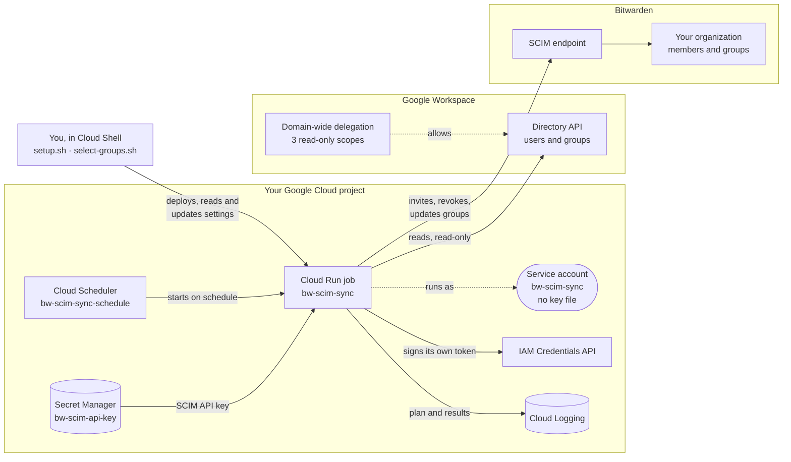

# Sync Google Workspace users and groups to Bitwarden (SCIM)

This tool keeps your Bitwarden organization in step with Google Workspace. On a schedule, it reads
the Google groups you choose and uses Bitwarden's SCIM endpoint to:

- invite new group members to your Bitwarden organization,
- revoke members who leave those groups or are suspended or deleted in Google,
- restore members who return, and
- create a matching Bitwarden group for each Google group and keep its membership current. People
  in groups nested inside a chosen group count as its members.

It runs in your own Google Cloud project as a small scheduled job, so you don't need a server.
Setup takes about 15 minutes.

**Contents:** [How it works](#how-it-works) · [Before you start](#before-you-start) ·
[Step 1](#step-1-enable-scim-in-bitwarden) · [Step 2](#step-2-set-up-google-cloud) ·
[Step 3](#step-3-allow-the-sync-to-read-your-directory) · [Step 4](#step-4-choose-the-groups-to-sync) ·
[Step 5](#step-5-test-with-a-dry-run) · [Step 6](#step-6-turn-on-syncing) ·
[After setup](#after-setup)

| Guide | For |
|---|---|
| This README | Setting up the sync, Steps 1 to 6. |
| [Admin guide](docs/ADMIN_GUIDE.md) | Checking that a sync worked, reading the plan, which people are synced (including nested groups), settings, everyday tasks and troubleshooting. |
| [Manual setup](docs/MANUAL_SETUP.md) | Doing Step 2 by hand in the Google Cloud console instead of with `setup.sh`. |
| [Architecture](docs/ARCHITECTURE.md) | Diagrams of the components, a sync run and the code. |
| [Testing](docs/TESTING.md) | Validating the sync before release (maintainers). |

## How it works

| Piece | Where | Purpose |
|---|---|---|
| Cloud Run job `bw-scim-sync` | Your Google Cloud project | Runs one sync pass and exits. |
| Cloud Scheduler job `bw-scim-sync-schedule` | Your Google Cloud project | Starts the job on a schedule (hourly by default). |
| Secret `bw-scim-api-key` | Secret Manager in your project | Holds the Bitwarden SCIM API key. |
| Service account `bw-scim-sync` | Your Google Cloud project | The identity the job runs as. No key file is ever created for it. |
| Domain-wide delegation | Google Admin console | Lets the service account **read** users and groups. It can't change anything in Google Workspace. |



More diagrams, including one sync run step by step, are in [docs/ARCHITECTURE.md](docs/ARCHITECTURE.md).

## Before you start

You need:

- **A Bitwarden organization on a plan that includes SCIM**, and Owner or Admin access to it.
- **A Google Workspace super admin**, for one step in the Admin console.
- **A Google Cloud project with billing enabled**, and an account that can manage it. Project
  **Owner** is simplest. The job uses a few seconds of compute per run, which normally fits in the
  free tier.
- **To know which Google groups** should get Bitwarden access. You pick them from a list of your
  groups in Step 4, so you don't need to type their addresses.

Good to know before you choose groups:

- Only **users of your Google Workspace** are synced. Group members with outside addresses (for
  example, a personal Gmail account added to a group) are skipped, and the log says so.
- **Groups inside a synced group count too.** If `engineering@` contains the group `backend@`, the
  people in `backend@` (at any depth) are invited and added to the Bitwarden group `Engineering`.
  `backend@` doesn't get a Bitwarden group of its own unless you pick it as well. See
  [Nested groups](docs/ADMIN_GUIDE.md#nested-groups).
- **Use only one sync tool per Bitwarden organization.** If you use Bitwarden Directory Connector or
  another SCIM integration for this organization, turn it off first.

## Step 1: Enable SCIM in Bitwarden

1. In the Bitwarden web app, open the **Admin Console** for your organization.
2. Go to **Settings → SCIM provisioning**.
3. Turn on **Enable SCIM** and select **Save**.
4. Copy the **SCIM URL** and the **SCIM API key**. You'll enter them in Step 2.

Treat the API key like a password: anyone who has it can add and remove members of your
organization. Don't paste it into email, chat or tickets.

## Step 2: Set up Google Cloud

The setup script does all of the Google Cloud work in one go. If your organization prefers to make
each change by hand, follow [docs/MANUAL_SETUP.md](docs/MANUAL_SETUP.md) instead, then continue with Step 3.

1. Open [Google Cloud Shell](https://shell.cloud.google.com) and select your project at the top of
   the page.
2. Upload `bw-gws-scim-sync.zip` with the **⋮ (More) → Upload** menu, then unzip it and open the
   folder:
   ```
   unzip bw-gws-scim-sync.zip && cd bw-gws-scim-sync
   ```
3. Run the script:
   ```
   bash setup.sh
   ```
4. Answer the prompts. Press **Enter** to accept a value shown in brackets.

| Prompt | What to enter |
|---|---|
| Google Cloud project ID | Your project. It's usually filled in for you. |
| Region | Where the job runs, for example `us-central1` or `europe-west1`. |
| Bitwarden SCIM URL | The URL from Step 1. |
| Bitwarden SCIM API key | The key from Step 1. What you type is hidden. |
| Google Workspace admin email | An admin account the sync reads your directory as. Its access is read-only. |
| Google group email(s) | **Press Enter to skip**, and pick the groups from your directory in Step 4. Or type one or more group emails, separated by commas, for example `engineering@acme.com,finance@acme.com`. |
| Sync schedule (cron) | How often to sync. The default `0 * * * *` runs at the start of every hour. |
| Schedule time zone | The time zone for the schedule, for example `America/New_York`. The default is `Etc/UTC`. |

The script then:

1. Checks that the project exists and has billing.
2. Turns on the Google Cloud APIs the job needs.
3. Creates the `bw-scim-sync` service account and lets it sign its own directory-access tokens.
4. Stores the SCIM API key in Secret Manager as `bw-scim-api-key`.
5. Builds the job from this folder and deploys it. **A new job starts in dry-run mode, so it doesn't
   change anything in Bitwarden yet.**
6. Creates the schedule.

When it finishes, it prints a **Client ID**, a list of **OAuth scopes**, and the next steps. Keep
them for Step 3.

It's safe to run the script again, for example to change the SCIM URL, the admin email, the groups
or the schedule, or to install a new version. On a rerun it reads the deployed job, its schedule
and the stored key, and shows the current values in brackets: press **Enter** to keep each one. At
the API key prompt, **Enter** keeps the stored key. It then updates everything in place and keeps
settings it doesn't ask about, such as `DRY_RUN` and `PROTECTED_EMAILS`.

> **Tip:** to skip the prompts, set the answers as environment variables first, for example
> `PROJECT_ID=my-project REGION=us-central1 bash setup.sh`. The variable names are `PROJECT_ID`,
> `REGION`, `BW_SCIM_URL`, `BW_SCIM_API_KEY`, `GOOGLE_ADMIN_EMAIL`, `GOOGLE_GROUPS`, `SCHEDULE` and
> `TIME_ZONE`.

## Step 3: Allow the sync to read your directory

1. Sign in to the Google Admin console as a super admin and open
   [domain-wide delegation](https://admin.google.com/ac/owl/domainwidedelegation)
   (**Security → Access and data control → API controls → Manage domain-wide delegation**).
2. Select **Add new**.
3. In **Client ID**, paste the Client ID the script printed.
4. In **OAuth scopes**, paste this single line:
   ```
   https://www.googleapis.com/auth/admin.directory.user.readonly,https://www.googleapis.com/auth/admin.directory.group.readonly,https://www.googleapis.com/auth/admin.directory.group.member.readonly
   ```
5. Select **Authorize**.

All three scopes are read-only. The change usually takes effect within a few minutes, but can take
longer.

If you lose the Client ID, find it in the Google Cloud console under **IAM & Admin → Service
accounts → bw-scim-sync → Unique ID**, or run:
`gcloud iam service-accounts describe bw-scim-sync@YOUR_PROJECT.iam.gserviceaccount.com --format 'value(oauth2ClientId)'`

## Step 4: Choose the groups to sync

In Cloud Shell, in the same folder as Step 2, run:

```
bash select-groups.sh
```

1. Enter your project and the job's region if asked.
2. The script lists every group in your Google Workspace, with its number of direct members (a
   group inside it counts as one). Groups that are already synced are ticked. You only need to pick
   the top group: people in groups nested inside it are included.
3. Select groups with the arrow keys and **Space**. Press **/** and type to filter the list (for
   example `eng`), then **Enter** to go back to the list.
4. Press **Enter** to finish, or **q** to cancel without changes.
5. The script shows the groups you added and removed. Answer **y** to save them on the job.
6. Answer **Enter** (yes) to run a dry run straight away. It shows the plan in Cloud Shell; see Step 5
   for what it means.

The first run takes a little longer: it installs the tool's Python libraries in the folder, and
gives your account permission to read the directory with the sync's read-only access. If it says
it's waiting for permission, that's normal for a minute or two.

If the arrow keys don't work in your terminal, the script falls back to a numbered list: type the
numbers to select (for example `1,3,5-7`), `/text` to filter, and `s` to save.

You can run `select-groups.sh` again at any time to change the groups.

## Step 5: Test with a dry run

If you ran the dry run at the end of Step 4, you've already seen the plan. Run one on Google Cloud
as well, which also shows that the job itself works:

1. In Cloud Shell, run:
   ```
   gcloud run jobs execute bw-scim-sync --region YOUR_REGION --wait
   ```
2. In the Google Cloud console, open **Cloud Run → Jobs → bw-scim-sync**, select the latest
   execution, and select task `0` to open its logs.
3. Expand the **Sync plan** entry, then **jsonPayload → plan**. It lists who would be invited
   (`create_users`), restored (`reactivate`) and revoked (`revoke`), and which groups would be
   created or updated, each with a **reason** such as `in Engineering` or
   `no longer in any synced group`. [Read the sync plan](docs/ADMIN_GUIDE.md#read-the-sync-plan)
   explains every field and reason.
4. Check the plan, especially `revoke`, and any **WARNING** entries above it. If the run fails with
   `unauthorized_client`, the change from Step 3 isn't active yet: wait a few minutes and run it
   again.

Nothing changes in Bitwarden during a dry run.

## Step 6: Turn on syncing

When the plan looks right, run:

```
gcloud run jobs update bw-scim-sync --region YOUR_REGION --update-env-vars DRY_RUN=false
```

From now on, the schedule applies changes automatically. Run the `execute` command from Step 5 once
more to sync now, then follow [Check that a sync worked](docs/ADMIN_GUIDE.md#check-that-a-sync-worked):
the log shows entries such as `Invited user` and `Created group`, and the people appear on the
**Members → Invited** tab in the Bitwarden Admin Console.

## After setup

The [admin guide](docs/ADMIN_GUIDE.md) covers running the sync day to day:

- [Check that a sync worked](docs/ADMIN_GUIDE.md#check-that-a-sync-worked): the run, its log, and
  what to look for in Bitwarden.
- [Which people are synced](docs/ADMIN_GUIDE.md#which-people-are-synced), including
  [nested groups](docs/ADMIN_GUIDE.md#nested-groups).
- [Existing members and groups](docs/ADMIN_GUIDE.md#existing-members-and-groups) and
  [what users and admins see](docs/ADMIN_GUIDE.md#what-users-and-admins-see).
- [Everyday tasks](docs/ADMIN_GUIDE.md#everyday-tasks): change groups, rotate the key, pause, update,
  uninstall.
- [Settings](docs/ADMIN_GUIDE.md#settings), [self-hosted Bitwarden](docs/ADMIN_GUIDE.md#self-hosted-bitwarden)
  and [troubleshooting](docs/ADMIN_GUIDE.md#troubleshooting).
