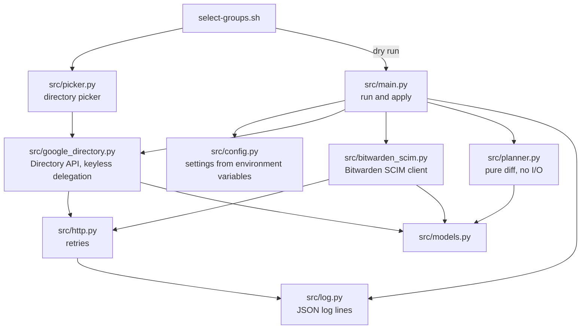
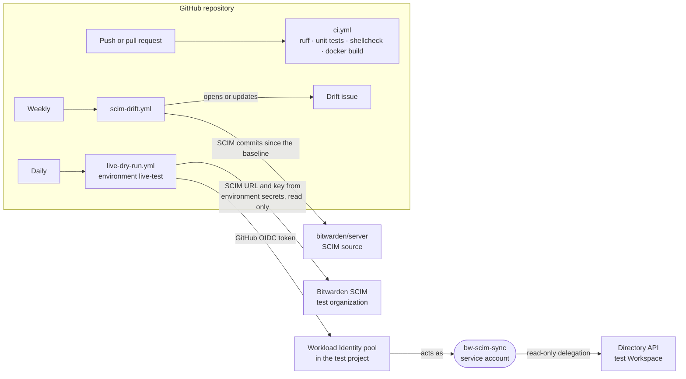

# Testing guide

This guide is for whoever validates the sync before it goes to customers. The end-user setup guide
is README.md.

**Never point a test run at a production Bitwarden organization or a production Google tenant.**

## 1. Unit tests

These need no network access and no accounts.

```bash
python -m venv .venv && source .venv/bin/activate
pip install -r requirements.txt
python -m unittest discover -s tests -t . -v
```

- `tests/test_planner.py` covers the decision logic: who gets invited, restored, revoked or deleted;
  how suspended Google users, protected emails and other identity providers' members are handled;
  how groups are matched; and `ADOPT_GROUPS` / `ADOPT_USERS`.
- `tests/test_picker.py` covers the directory picker used by `select-groups.sh`: selection parsing
  (`1,3,5-7`), filtering, the numbered-list flow, keeping saved emails missing from the directory,
  and how groups and users are listed.
- `tests/test_scim_client.py` runs the SCIM client and the full apply step against an in-process fake
  SCIM server. It covers pagination, invites, revoke, group create, group PUT and PATCH, linking
  adopted groups and users, and an idempotent second run.

The fake server mirrors the bitwarden/server behaviors listed in section 5 (for example, group
responses never include members, and PUT ignores `externalId`). A passing run proves the code is
consistent with those behaviors, not that a live Bitwarden org behaves the same way.

GitHub Actions runs these on every push and pull request (`.github/workflows/ci.yml`), together with
`ruff`, `shellcheck setup.sh`, and a `docker build` that checks the image runs as a non-root user.
A weekly workflow (`.github/workflows/scim-drift.yml`) opens an issue when Bitwarden's SCIM code
changes after the commit section 5 was verified against.

A daily workflow (`.github/workflows/live-dry-run.yml`) runs the real sync against the test Workspace
and Bitwarden org with `DRY_RUN` forced on, and writes the planned changes to the job summary. Its
settings live in the `live-test` GitHub environment (limited to `main`): secrets `BW_SCIM_URL` and
`BW_SCIM_API_KEY`, variables `GOOGLE_ADMIN_EMAIL`, `GOOGLE_SA_EMAIL`, `GOOGLE_GROUPS` and
`GCP_WIF_PROVIDER`. Google access uses Workload Identity Federation, so no Google key is stored in
GitHub. After rotating the SCIM key, update it with
`gh secret set BW_SCIM_API_KEY --env live-test`.

How the code fits together (maintainers):



How the GitHub workflows connect to the test environment:



## 2. Test environment

You need:

- **A Google Workspace test tenant**, with a super admin account.
- **A Google Cloud project** for the service account. In section 4, it also hosts the Cloud Run job.
- **A Bitwarden test organization** with SCIM enabled (Admin Console → Settings → SCIM
  provisioning). Use cloud, or a local or self-hosted server built from `bitwarden/server`. Make
  sure your own owner account isn't in any Google group you sync.

Create these test fixtures in Google:

| Fixture | Purpose |
|---|---|
| `bw-sync-test@` group containing user **T1** | Basic invite and group sync |
| `bw-sync-parent@` group whose only member is the group `bw-sync-child@`, which contains user **T2** | Nested-group flattening |
| User **T3**, initially in `bw-sync-test@` | Suspend and revoke tests |
| User **T4** invited to Bitwarden by hand, not in any synced group | Must never be touched |
| User **T6** invited to Bitwarden by hand **and** in `bw-sync-test@` | Email matching and `ADOPT_USERS` |
| `bw-sync-legacy@` group containing T1, plus a Bitwarden group named `bw-sync-legacy` created by hand with T4 as its member | Same-name protection and `ADOPT_GROUPS` |

## 3. Running locally

Run `setup.sh` once against the test project, or create the service account and domain-wide
delegation by hand as README.md describes. Then allow your own Google account to sign as that
service account:

```bash
gcloud auth application-default login
gcloud iam service-accounts add-iam-policy-binding bw-scim-sync@PROJECT.iam.gserviceaccount.com \
  --member user:you@yourdomain.com --role roles/iam.serviceAccountTokenCreator
```

A new IAM grant can take a few minutes to apply. Until it does, runs fail with
`Error calling the IAM signBlob API ... 403`; wait and retry. If they keep failing, check that
`gcloud auth application-default login` used the account you granted.

Put the settings in a `.env.test` file. `.gitignore` already excludes `.env*` files, so don't commit them.

```bash
BW_SCIM_URL=https://scim.bitwarden.com/v2/<test-org-id>
BW_SCIM_API_KEY=...
GOOGLE_ADMIN_EMAIL=admin@test-tenant.com
GOOGLE_SA_EMAIL=bw-scim-sync@PROJECT.iam.gserviceaccount.com
GOOGLE_GROUPS=bw-sync-test@test-tenant.com,bw-sync-parent@test-tenant.com
DRY_RUN=true
```

Load the file and run:

```bash
set -a; source .env.test; set +a
python -m src.main | jq .
```

To use a service-account key instead of keyless signing, set `GOOGLE_SA_KEY_JSON` to the key file's
contents. This only works if the project's organization policy allows key creation.

The script exits with one of these codes:

| Code | Meaning |
|---|---|
| `0` | Success, or a dry run that completed |
| `1` | One or more SCIM calls failed. The run continues past individual failures. |
| `2` | The synced groups have no active members, so the run refused to start |
| `3` | The planned removals exceed `MAX_REMOVALS`, so the run refused to start |

Any other crash, such as a Google 404 for a mistyped group, exits non-zero with a traceback before
changing anything.

## 4. Test sequence

Run these in order. Start every step with `DRY_RUN=true`, read the plan, and then rerun with
`DRY_RUN=false`. This tests the dry-run plan as well as the real changes.

| # | Action | Expected result |
|---|---|---|
| 1 | First dry run | Plan invites T1, T2 and T3, and creates both groups. No removals. Nothing changes in Bitwarden. |
| 2 | Same with `DRY_RUN=false` | T1, T2 and T3 get invitation emails. Groups `bw-sync-test` and `bw-sync-parent` exist, and the parent group contains T2. |
| 3 | Run again with no changes in Google | No invites or revokes. One PUT (or PATCH in `patch` mode) per group. |
| 4 | Add a new user T5 to `bw-sync-child@` | T5 is invited and appears in `bw-sync-parent`. |
| 5 | Remove T1 from `bw-sync-test@` | T1 is revoked, not deleted, and removed from the group. |
| 6 | Add T1 back | T1 is restored and back in the group. |
| 7 | Suspend T3 in Google | T3 is revoked. |
| 8 | Check T4 after every step | T4 is never touched. |
| 9 | Set `MAX_REMOVALS=0`, then remove someone from a group | The run exits with code 3 and changes nothing. |
| 10 | Set `PROTECTED_EMAILS` to include T5, then remove T5 from the group | T5 isn't revoked, and the log has a warning. |
| 11 | Set `GOOGLE_GROUPS` to a group that doesn't exist | The run fails with a Google 404 and changes nothing. |
| 12 | Set `REMOVAL_ACTION=delete` and remove T5 (optional) | T5 is removed from the organization. |
| 13 | Rotate the SCIM API key in Bitwarden without updating the job | The run fails with 401. Storing the new key (README, "Rotate the SCIM API key") fixes it. |
| 14 | Add `bw-sync-legacy@` to `GOOGLE_GROUPS` | The plan warns `Bitwarden already has a group named "bw-sync-legacy"` and doesn't update it. T4 is still its only member. |
| 15 | Set `ADOPT_GROUPS=bw-sync-legacy@...` | The group's members become T1 only, and the log shows `Linked group`. The next run without `ADOPT_GROUPS` still updates it (matched by externalId). |
| 16 | T6 in `bw-sync-test@`, default settings | T6 is added to the group, not invited again. Removing T6 from the Google group doesn't revoke T6. |
| 17 | Set `ADOPT_USERS=<T6 email>` with T6 in the group | The plan lists T6 under `adopt_users`, and the log shows `Adopted user`. Removing T6 from the group then revokes T6. |

Then test the Cloud Run deployment in a fresh project:

| # | Action | Expected result |
|---|---|---|
| 18 | `bash setup.sh` in Cloud Shell | Completes and prints the Client ID and scopes. Rerunning it also succeeds. |
| 19 | `gcloud run jobs execute bw-scim-sync --region R --wait` | Completes. The dry-run plan appears in the job's logs. |
| 20 | `gcloud scheduler jobs run bw-scim-sync-schedule --location R` | Starts a new job execution. |
| 21 | Set `DRY_RUN=false` and `PROTECTED_EMAILS=x@...` on the job, then rerun `bash setup.sh` | Both settings are unchanged afterwards (`gcloud run jobs describe bw-scim-sync --region R`). |
| 22 | Repeat 18–20 following MANUAL_SETUP.md instead of `setup.sh`, in another fresh project | Same results. Note any console labels that differ from the guide and fix the guide. |
| 23 | Run `setup.sh` pressing Enter at the group prompt, finish Step 3, then `bash select-groups.sh` | The job deploys without `GOOGLE_GROUPS`. The picker lists every Workspace group with member counts; arrow keys, Space, `/` filter and Enter work. After saving, `gcloud run jobs describe` shows the chosen `GOOGLE_GROUPS`, and the offered dry run prints a plan. |
| 24 | Run `select-groups.sh` again, change nothing, press Enter | It says `No changes.` and doesn't offer to save. `q` cancels without changes. |
| 25 | `select-groups.sh --protected-users`, pick T4; then `--adopt-users`, pick T6 | `PROTECTED_EMAILS` and `ADOPT_USERS` hold those emails. Unselecting everyone removes the variable. |
| 26 | Run `select-groups.sh` from an account that has never used it | It grants that account Token Creator on the service account, waits through the `signBlob` delay, then lists groups. |
| 27 | Rerun `bash setup.sh` on a deployed job | It says it found the job, and every prompt shows the current value in brackets (SCIM URL, admin email, groups, schedule, time zone). Enter keeps each one. Enter at the key prompt prints `Keeping the stored key`, and `gcloud secrets versions list bw-scim-api-key` shows no new version. |
| 28 | Rerun `bash setup.sh` and change only the schedule | The scheduler job has the new schedule. The job's environment variables are unchanged. |

## 5. Bitwarden SCIM behavior to confirm

These behaviors were checked against `bitwarden_license/src/Scim/` in `bitwarden/server`
(`main`, commit 4aa2373b, 2026-10-20). The weekly drift workflow reports later changes to that code.
**Status:** *source* = confirmed in the server code; *live* = observed against a real org;
*open* = still to confirm.

| Behavior | Status | How to check |
|---|---|---|
| `PUT /Groups/{id}` with `members` replaces membership; omitting `members` leaves it alone (`Groups/PutGroupCommand.cs`) | source | Step 2 |
| `PUT /Groups/{id}` ignores `externalId`, so adopted groups are linked with PATCH `replace externalId` (`Groups/PatchGroupCommand.cs`) | source | Step 15 |
| `GET /Groups` and `GET /Groups/{id}` never return `members` (`Models/ScimGroupResponseModel.cs`) | source | — |
| PATCH `replace` on `members` and `displayName` is accepted | source | Steps 3–6 in `patch` mode |
| PATCH `replace` on a member's `externalId` is accepted; `add` is ignored (`Users/PatchUserCommand.cs`) | source | Step 17 |
| `POST /Users` returns 409 if the email or `externalId` already exists, and sends an invite unless the org disabled it (`Users/PostUserCommand.cs`) | source | Step 2 |
| PATCH `{"op":"replace","path":"active","value":false}` revokes a member and `true` restores one | source | Steps 5–7 |
| `Content-Type: application/scim+json` is accepted | source | Any write |
| `GET /Users` and `GET /Groups` paginate with `startIndex` (1-based) and `count` (no maximum); the list key is lowercase `resources` | source, live | Step 1 |
| `GET /Users` lists every member, including owners and manually invited members, with `externalId` and `emails` | live (29 members, 2026-10-20) | Step 1 plan and T4 |
| Bitwarden rejects revoking or deleting the last confirmed owner with 400 | source | — |
| Directory Connector (Google Workspace source) stores the Google user ID as `externalId` | open | Sync a test org with Directory Connector first, then run this tool. Users should match without new invites. |

Known limits, which are expected behavior rather than bugs:

- Name and email changes in Google aren't pushed to Bitwarden.
- Removing a group from `GOOGLE_GROUPS` leaves its Bitwarden group in place.
- Collection access is never managed.

## 6. Reading logs

Local runs print JSON lines to stdout. Cloud Run sends the same lines to Cloud Logging:

```bash
gcloud logging read 'resource.type="cloud_run_job" AND resource.labels.job_name="bw-scim-sync"' \
  --freshness 1h --limit 100 --format 'value(jsonPayload)'
```

The `Sync plan` entry shows everything the run intended to do. Each change is then logged as its own
line: `Invited user`, `Restored user`, `Revoked user`, `Removed user`, `Adopted user`,
`Created group`, `Updated group` (with the strategy used) and `Linked group`. Things skipped on
purpose are logged as `WARNING` before the plan, for example same-named groups, members outside the
Workspace, and members owned by another tool.
Failures are logged at `ERROR` severity with the SCIM status code.

## 7. Recording results

Copy this table into the ticket or PR for each test round.

| Date | Tester | Bitwarden env (US / EU / self-hosted + version) | GROUP_UPDATE_MODE | Steps passed | Issues |
|---|---|---|---|---|---|
| 2026-10-20 | Bitwarden team (local runs) | US cloud | put | 1 (dry runs only), 11 (Google 404), 14 | Test Workspace has one user, so most steps need more fixtures. Found and fixed: same-named groups were overwritten; PUT ignores `externalId`. No writes yet. |
