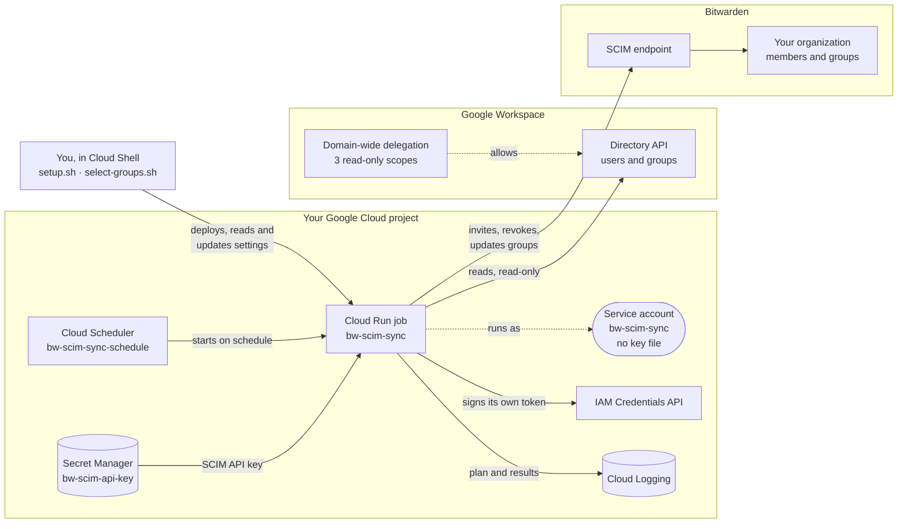
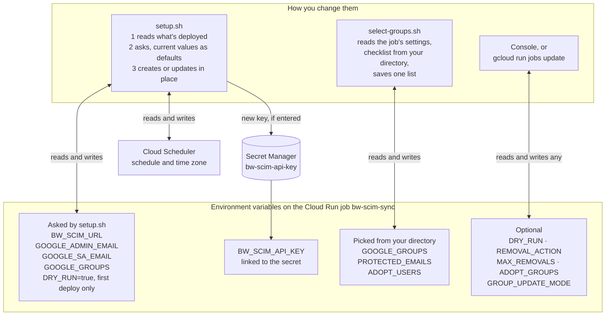
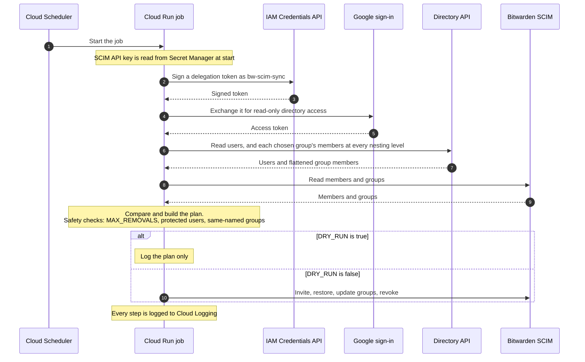
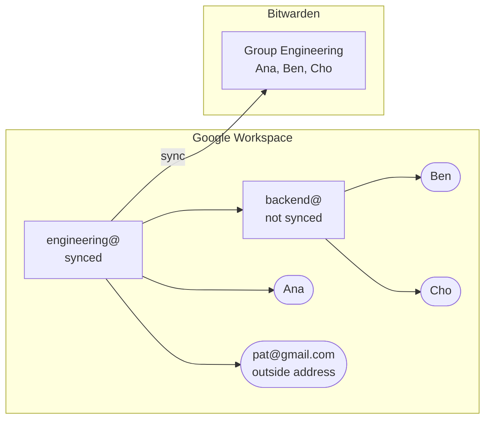
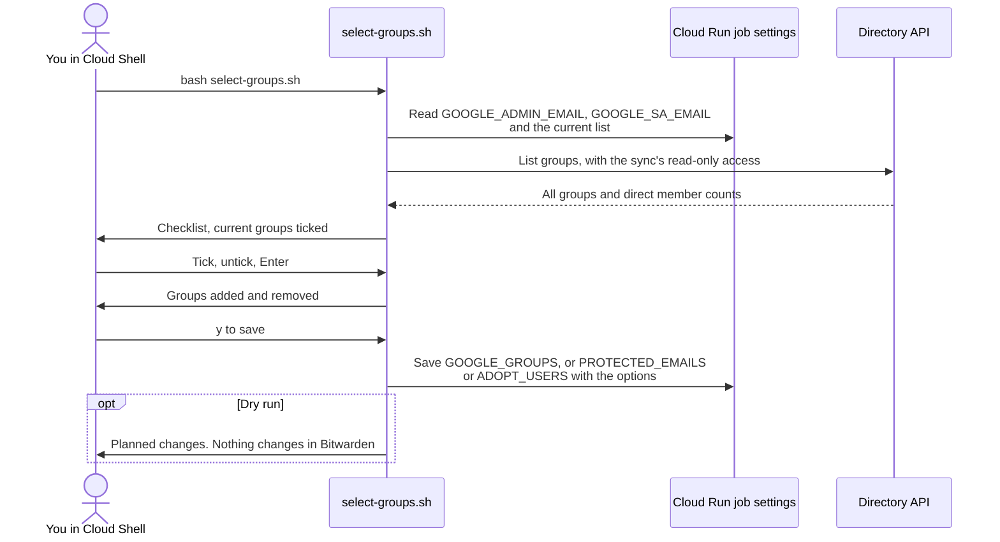
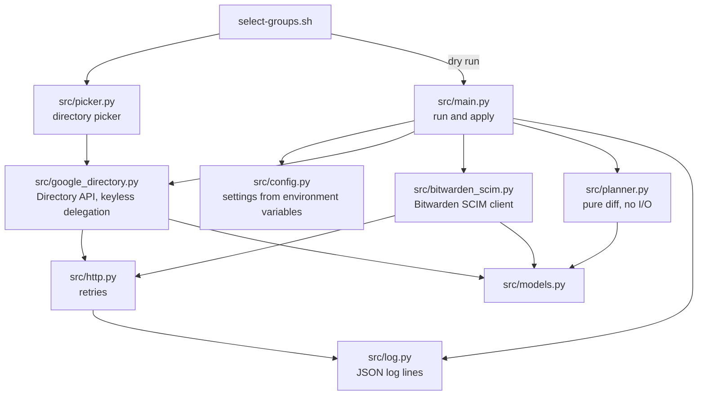
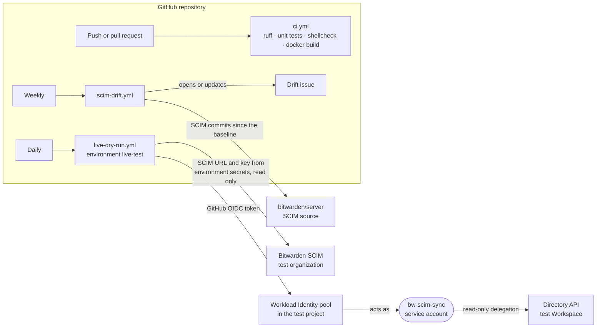

# How the sync is built

Diagrams of what runs where, how settings flow, and how the code fits together. You don't need this
page to set up or run the sync; see [README.md](../README.md) and the
[admin guide](ADMIN_GUIDE.md).

## Components

## Where the settings live

The job's settings are environment variables on the Cloud Run job. See
[Settings](ADMIN_GUIDE.md#settings) for what each one does.

## One sync run

## Nested groups

Only the groups in `GOOGLE_GROUPS` become Bitwarden groups. For each one, the sync asks Google for
its members at every level of nesting and keeps only people. A group inside it is not created in
Bitwarden; its people are added to the parent's Bitwarden group instead.

`pat@gmail.com` is skipped because only users of your Google Workspace are synced. `backend@` gets
no Bitwarden group of its own unless you also pick it.

## select-groups.sh

## Code (maintainers)

Nested membership is flattened by Google, not by this code: `get_group` in
`src/google_directory.py` lists members with `includeDerivedMembership=true` and keeps entries of
type `USER`.

## GitHub workflows and the test environment (maintainers)

